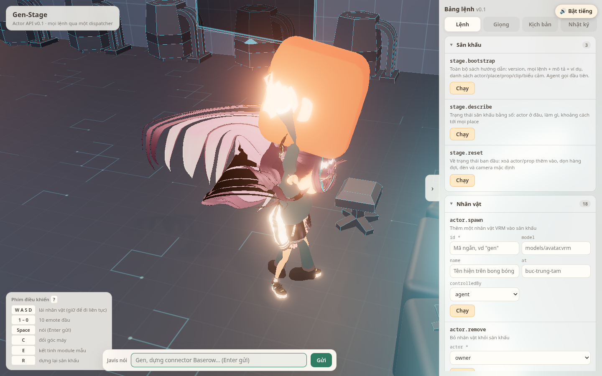
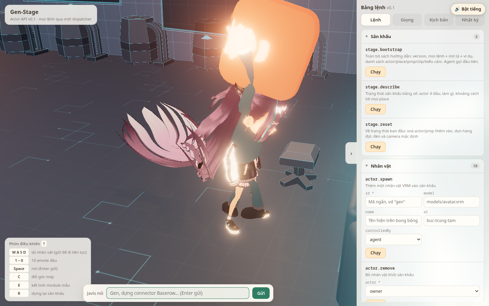
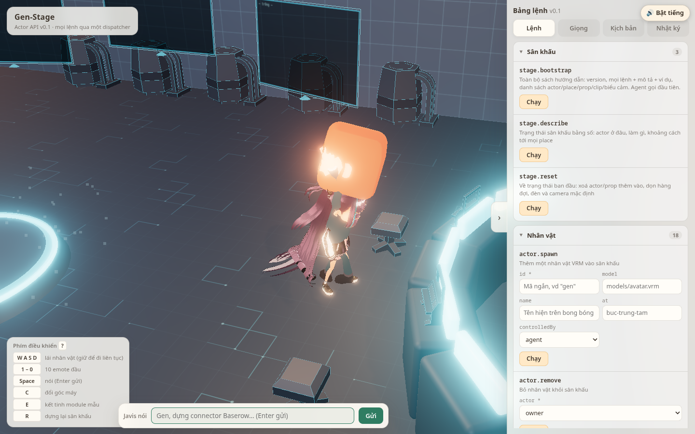
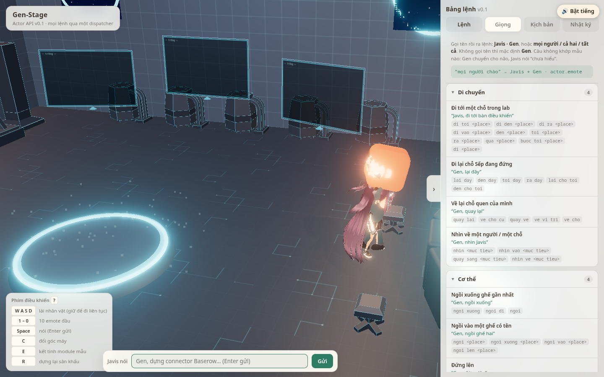
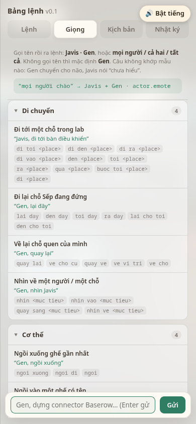
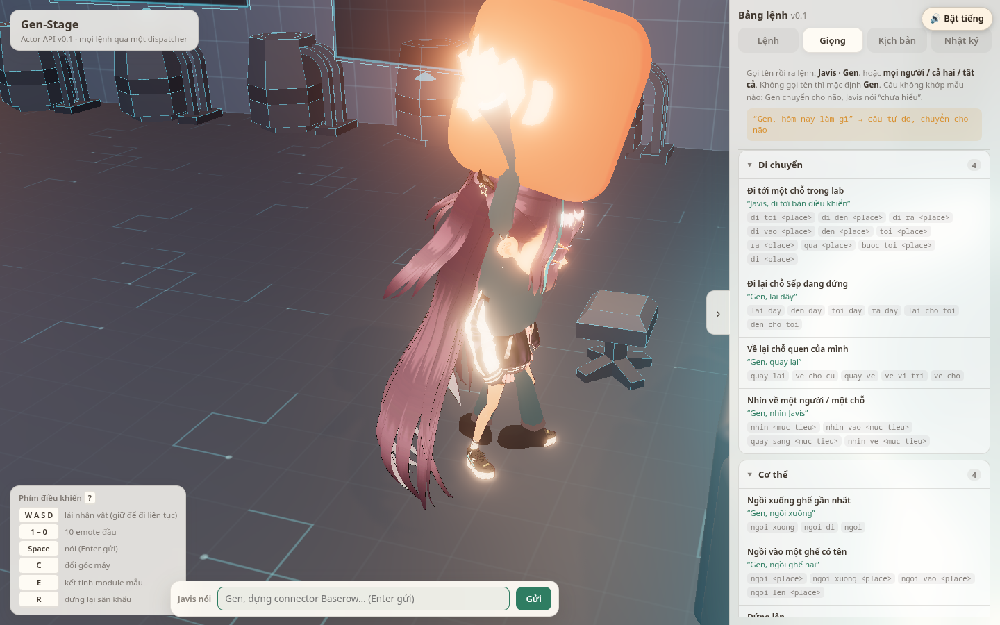

# C2 — Hiểu lệnh giọng cho mọi nhân vật (Issue #32)

Chạy: 2026-10-25T23:53:20.147Z · cổng riêng ws 8817 / tts 8818 / mcp 8819.
Số đo đầy đủ: `nhat-ky-kiem-c2.json`. Bảng dưới do `pnpm test` sinh
(`src/behavior/__tests__/c2-hieu-lenh.test.ts`), không gõ tay con số nào.

## Vòng kín trên app thật (Playwright + Chrome)

| Bước | Đạt | Chi tiết |
| --- | --- | --- |
| bridge bật cả ws + tts + mcp (cổng riêng) | ✓ | ws 8817 · tts 8818 · mcp 8819 |
| nhân vật nam hiện tên "Javis" (id vẫn là owner) | ✓ | [{"id":"owner","name":"Javis"},{"id":"gen","name":"Gen"}] |
| lớp hiểu lệnh khớp mẫu và bắn user.command | ✓ | {"text":"Javis, đi tới bàn điều khiển","actors":["owner"],"cmd":"actor.moveTo","args":{"actor":"owner","to":"ban-dieu-khien"},"mau":"moveTo","matched":true,"nhacLai":"đi tới bàn điều khiển"} |
| user.text của câu lệnh được đánh dấu handled (não bỏ qua) | ✓ | [{"text":"Javis, đi tới bàn điều khiển","handled":true},{"text":"Dạ, đi tới bàn điều khiển","handled":true}] |
| Javis đi tới bàn điều khiển thật | ✓ | arrived={"actor":"owner","to":"ban-dieu-khien","pos":[4.8,0,-1]} · at=ban-dieu-khien |
| Javis xác nhận ngắn bằng GIỌNG NAM, nhắc lại lệnh đã hiểu | ✓ | text="Dạ, đi tới bàn điều khiển" · voice=nam |
| Gen diễn emote "vui" | ✓ | user.command={"actor":"gen","emote":"vui"} · emote=vui |
| "mọi người chào" → CẢ HAI nhân vật cùng chào | ✓ | người nhận=["owner","gen"] · lệnh=owner:chao · gen:chao · emoteDone owner=true gen=true |
| tab "Giọng" liệt kê mẫu câu, sinh từ bảng ngữ pháp | ✓ | {"nhom":6,"mau":18,"cuoi":"“mọi người chào” → Javis + Gen · actor.emote"} |
| stage.describe trả lastCommand | ✓ | {"text":"mọi người chào","actor":"owner","cmd":"actor.emote","matched":true,"t":1792972472952} |
| mọi lệnh của lớp hiểu lệnh đi qua dispatcher (nguồn "giong") | ✓ | 11 lệnh: stage.bootstrap, stage.describe, actor.say, actor.moveTo, actor.emote |
| não nối MCP stdio và bắt đầu nghe | ✓ |  |
| câu tự do KHÔNG bị lớp hiểu lệnh ăn (không handled, không user.command) | ✓ | user.text={"actor":"owner","text":"Gen, hôm nay làm gì"} · user.command=null |
| não (nao-demo) nghe được câu đó và Gen diễn trên sân khấu | ✓ | emote=ra-lenh |
| nhật ký của não: nghe ĐÚNG câu tự do rồi tự chọn lệnh | ✓ | 10 tool call · câu nghe được: ["Gen, hôm nay làm gì"] |
| Gen trả lời bằng giọng thật (durationMs audio) theo lệnh của não | ✓ | "Xong rồi Sếp, gì đã kết tinh thành module. Em cất " 5208 ms |
| 0 lỗi console | ✓ |  |
| 30 câu: 100 % đúng người nhận | ✓ | 30/30 |
| 30 câu: ≥ 95 % đúng lệnh | ✓ | 30/30 = 100.0 % |
| 5 câu lỗi STT giả vẫn hiểu | ✓ | 5/5 |

## Bảng câu thử

### 30 câu Sếp hay nói

**30/30 đúng người nhận** · **30/30 đúng lệnh** (100.0 %)

| Câu Sếp nói | Người nhận | Lệnh đã gọi | Nhân vật nhắc lại | Đạt |
| --- | --- | --- | --- | --- |
| Javis, đi tới bàn điều khiển | owner | actor.moveTo | đi tới bàn điều khiển | ✓ |
| Gen, đi tới kệ module | gen | actor.moveTo | đi tới kệ module | ✓ |
| Javis ơi, đi ra cửa giúp em nhé | owner | actor.moveTo | đi tới cửa | ✓ |
| Gen qua bàn hai | gen | actor.moveTo | đi tới bàn hai | ✓ |
| Gen, đi tới bàn một | gen | actor.moveTo | đi tới bàn một | ✓ |
| đi tới bục trung tâm | gen | actor.moveTo | đi tới bục trung tâm | ✓ |
| Gen, lại đây | gen | actor.moveTo | lại chỗ Sếp | ✓ |
| Javis quay lại | owner | actor.moveTo | quay về chỗ cũ | ✓ |
| Gen, ngồi xuống | gen | actor.sit | ngồi xuống | ✓ |
| Gen ngồi ghế hai | gen | actor.sit | ngồi ghế hai | ✓ |
| Javis, đứng lên | owner | actor.stand | đứng lên | ✓ |
| Gen, dừng lại | gen | actor.stop | dừng lại | ✓ |
| Javis dừng | owner | actor.stop | dừng lại | ✓ |
| Gen, nhìn Javis | gen | actor.lookAt | nhìn Javis | ✓ |
| Javis, nhìn vào bàn điều khiển | owner | actor.lookAt | nhìn bàn điều khiển | ✓ |
| Gen, vui lên | gen | actor.emote | vui lên | ✓ |
| Javis, chào | owner | actor.emote | chào | ✓ |
| Gen ngạc nhiên đi | gen | actor.emote | ngạc nhiên | ✓ |
| Gen, suy nghĩ đi | gen | actor.emote | suy nghĩ | ✓ |
| Javis, ăn mừng | owner | actor.emote | ăn mừng | ✓ |
| Gen mệt rồi | gen | actor.emote | mệt | ✓ |
| mọi người chào | owner + gen | actor.emote | chào | ✓ |
| cả hai vui lên | owner + gen | actor.emote | vui lên | ✓ |
| tất cả đi tới bục trung tâm | owner + gen | actor.moveTo | đi tới bục trung tâm | ✓ |
| mở màn hình trái | gen | screen.show | mở màn hình trái | ✓ |
| tắt màn hình phải | gen | screen.clear | tắt màn hình phải | ✓ |
| đổi góc máy | gen | camera.preset | đổi góc máy | ✓ |
| dựng lại sân khấu | gen | stage.reset | dựng lại sân khấu | ✓ |
| Gen, hôm nay làm gì | gen | — (tới não) | — | ✓ |
| Gen, dự án Gen-Harness tới đâu rồi em | gen | — (tới não) | — | ✓ |

### 5 câu lỗi STT giả (mất dấu, sai một từ, số đếm bằng chữ)

**5/5 đúng người nhận** · **5/5 đúng lệnh** (100.0 %)

| Câu Sếp nói | Người nhận | Lệnh đã gọi | Nhân vật nhắc lại | Đạt |
| --- | --- | --- | --- | --- |
| javis di toi ban dieu khien | owner | actor.moveTo | đi tới bàn điều khiển | ✓ |
| Ja-vít, đi tới bàn điều khiểm | owner | actor.moveTo | đi tới bàn điều khiển | ✓ |
| Ghen, vui lên | gen | actor.emote | vui lên | ✓ |
| Gen ngoi ghe hai | gen | actor.sit | ngồi ghế hai | ✓ |
| moi nguoi chao | owner + gen | actor.emote | chào | ✓ |

## Ảnh

- 
- 
- 
- 
- 
- 
